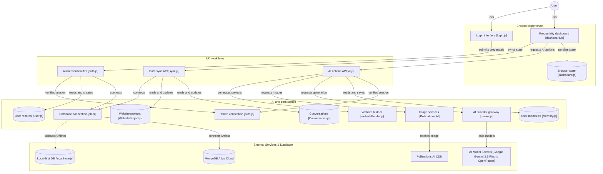

<div align="center">

# 🌌 NOVA AI — Next-Gen AI Productivity Command Center

**An advanced, multi-modal AI productivity platform and developer workspace featuring a Vibrant Neo-Glass aesthetic, real-time intelligence, local-first resilience, and enterprise cloud sync.**

*Created with passion by **[Rohan Mondal](https://github.com/rohanmondal)***

---

[](https://nodejs.org/)
[](https://developer.mozilla.org/en-US/docs/Web/JavaScript)
[](https://ai.google.dev/)
[](https://www.mongodb.com/)
[](LICENSE)

[Live Demo](http://localhost:3000/) • [Features](#-core-features) • [Architecture](#-system-architecture) • [Quick Start](#-quick-start) • [API Reference](#-api-endpoints) • [Deployment](#-deployment)

</div>

---

## 📖 Overview

**NOVA AI** is a full-stack, local-first web application designed to unify everyday engineering, creative ideation, and business productivity into a tactile, distraction-free environment. 

Unlike conventional flat or dark dashboards, NOVA AI introduces a signature **Vibrant Neo-Glass (Neumorphism + Frosted Glassmorphism)** design system:
- **Soft Pearl Ice-Blue Base (`#eef3fb`)** accented by subtle, diffused background **Aurora mesh blobs** (`#00d2ff`, `#4f46e5`, `#9333ea`, `#f43f5e`).
- **Semi-Translucent Frosted Panels (`rgba(255, 255, 255, 0.65)`)** with `backdrop-filter: blur(20px) saturate(180%)`.
- **Tactile Dual Drop Shadows:** Crisp top-left pure white outer glow paired with colorful tinted blue-violet bottom-right depth.
- **Specular Glass Edges:** 1.5px refractive gradient borders transitioning from pure white specular reflections to translucent iridescent rims.
- **Concave Inset Input Sheens:** Carved inward composer pills and search fields providing physical tactile feedback.

---

## ✨ Core Features

### 1. 💬 AI Chat & Long-Term Memory Engine
- **Multi-Turn Context Streaming:** Maintains recent conversational history and streams natural, formatted responses without robotic boilerplate.
- **Automatic Memory Extraction:** Passively extracts and remembers user preferences, active project titles, personal goals, and career roles across sessions.
- **Gemini Quick-Action Cards:** Clickable prompt chips (*Code with NOVA*, *Ideate SaaS Ideas*, *Daily Schedule*, *Multi-Page Website Studio*) that instantly scaffold requests into the chat stream.

### 2. 🗂️ Segmented Dual-Pane Navigation
- **`[ Chat ]` Tab:** Dedicated conversation management featuring real-time client-side thread search, instant `+ New Chat` generation, and recent chat history with timestamps.
- **`[ Mode ]` Tab:** Clean 12-tool workspace launcher routing between AI Chat, AI Studio, Web Studio, Daily Planner, Tasks, Prompt Library, Cloud Sync, and Settings.

### 3. 🌐 AI Multi-File Website Studio
- **Full-Stack Site Generation:** Generates comprehensive multi-file website projects (`index.html`, `about.html`, `styles.css`, `README.md`) based on plain-text descriptions.
- **Interactive Sandboxed Preview:** Renders generated websites directly within an isolated iframe with client-side multi-page routing interception.
- **Deterministic Auto-Repair:** Validates HTML structure and injects fallback styling to ensure every generation renders flawlessly.
- **Direct ZIP Export:** Download generated projects ready for production deployment.

### 4. 📅 AI Daily Productivity Planner
- **Structured Schedule Blocks:** Converts broad goals or daily tasks into timed, prioritized focus blocks (Deep Work, AI Collaboration, Execution Sprint, QA, Wrap-up).
- **Interactive Timeline:** Dynamic status toggling and local state persistence.

### 5. 📄 AI Creative Studio & Document Generator
- Generates polished, publication-ready documents including **Executive Resumes**, **Cover Letters**, **Project Proposals**, and **Business Communications**.

### 6. 🎨 Multi-Modal Media Suite
- **AI Image Generation:** High-resolution visual synthesis powered by Pollinations AI.
- **AI Video Studio:** Text-to-video workflow pre-configured for Hugging Face inference pipelines.

### 7. 🔐 Dual-Mode Authentication & Local-First Resilience
- **JWT Authentication:** Secure user signup, login, password hashing (`bcryptjs`), and token verification (`jsonwebtoken`).
- **Zero-Lockout Guest Mode:** Opens immediately into a functional guest profile (*"Rohan Mondal"*) if offline or unauthenticated, avoiding redirect loops.
- **Graceful Fallbacks:** Operates seamlessly offline with in-memory/disk local storage (`data/local_db.json`) even if external cloud services (MongoDB Atlas / Google API keys) are not yet configured.

---

## 🏛️ System Architecture

### How NOVA AI Works
NOVA AI is a browser-based AI productivity workspace with serverless API handlers and mongoose-backed user data. The principal workflow is a user working in the dashboard, which requests AI assistance; the chat handler can use account-scoped memories and an AI provider to return a response. Authentication and conversation synchronization use separate API workflows. The architecture also handles image, planner, website, document, and video generation actions with local-first resilience.



### Component Breakdown
| Layer | Component | File Reference | Primary Responsibility |
| :--- | :--- | :--- | :--- |
| **Browser Experience** | Productivity Dashboard | [`dashboard.js`](dashboard.js) | UI state management, chat streaming, theme rendering, event orchestration |
| | Login Interface | [`login.js`](login.js) | Credential validation, JWT session hydration, guest mode triggering |
| | Browser State | `localStorage` | Client-side caching of chats, active projects, tasks, and auth tokens |
| **API Workflows** | Data Sync API | [`api/sync.js`](api/sync.js) | Debounced synchronization of conversations, multi-file websites, and tasks |
| | Authentication API | [`api/auth.js`](api/auth.js) | Signup, login, password comparison via `bcryptjs`, and session checks (`me`) |
| | AI Actions API | [`api/ai.js`](api/ai.js) | Central dispatcher for chat, planner, documents, websites, images, and video |
| **AI & Persistence** | Token Verification | [`api/_utils/auth.js`](api/_utils/auth.js) | Bearer JWT verification and authorization header inspection |
| | Database Connection | [`api/_utils/db.js`](api/_utils/db.js) | Mongoose connection manager with offline fallback detection |
| | AI Provider Gateway | [`api/_lib/gemini.js`](api/_lib/gemini.js) | Multi-tier fallback (Google Gemini 2.5 &rarr; OpenRouter &rarr; Local Engine) |
| | Website Builder | [`api/_lib/websiteBuilder.js`](api/_lib/websiteBuilder.js) | Multi-file HTML/CSS generator with sandboxed iframe navigation scripts |
| | Models & Schemas | `api/_models/*.js` | Mongoose schemas for User, Conversation, Memory, and WebsiteProject |
| **External Tier** | Cloud & Models | Google, OpenRouter, MongoDB | Production persistence and high-speed foundation model inference |

---

## 📂 Project Structure

```text
nova-ai/
├── api/                           # Serverless API endpoints
│   ├── _lib/
│   │   ├── gemini.js              # AI fallback orchestrator & local engine
│   │   └── websiteBuilder.js      # Multi-file web generator & HTML validator
│   ├── _models/                   # Mongoose Schemas (MongoDB Atlas)
│   │   ├── Conversation.js
│   │   ├── Memory.js
│   │   ├── User.js
│   │   ├── VideoProject.js
│   │   └── WebsiteProject.js
│   ├── _utils/
│   │   ├── auth.js                # JWT token verification
│   │   ├── db.js                  # Resilient MongoDB connector
│   │   └── localStore.js          # File-backed offline database fallback
│   ├── ai.js                      # Central AI action dispatcher
│   ├── auth.js                    # Auth gateway (login, signup, session check)
│   └── sync.js                    # Cloud and local state synchronization
├── data/
│   └── local_db.json              # Local persistent offline database
├── config.js                      # Client runtime backend configuration
├── dashboard.html                 # Main Neo-Glass Command Center UI
├── dashboard.js                   # Client state management, chat streaming, UI logic
├── index.html                     # Landing & presentation entry
├── login.html                     # Neumorphic authentication page
├── login.js                       # Auth submission & token handling
├── package.json                   # Dependencies & npm scripts
├── server.js                      # Unified local Node.js development server
├── styles.css                     # Neo-Glass & Neumorphism design system
└── vercel.json                    # Vercel production deployment configuration
```

---

## 🚀 Quick Start

### Prerequisites
- **Node.js** (v18.0.0 or higher recommended)
- **npm** (v9.0.0 or higher)

### 1. Clone or Extract
```bash
git clone https://github.com/rohanmondal/nova-ai.git
cd nova-ai
```

### 2. Install Dependencies
```bash
npm install
```

### 3. Configure Environment (Optional)
Create a `.env` file in the root directory (see [`.env.example`](.env.example)):
```env
PORT=3000
GOOGLE_API_KEY=your_gemini_api_key_here
MONGODB_URI=your_mongodb_atlas_connection_string
JWT_SECRET=your_custom_jwt_secret_key
OPENROUTER_API_KEY=your_optional_openrouter_key
HUGGINGFACE_API_KEY=your_optional_hf_key
```
> [!NOTE]
> **Zero-Config Ready:** If `.env` is omitted, NOVA AI automatically boots with internal development secrets, file-backed offline storage, and resilient local AI generation engines.

### 4. Run the Server
```bash
npm start
```

### 5. Access the Platform
- **Command Center Dashboard:** [http://localhost:3000/](http://localhost:3000/) or [http://localhost:3000/dashboard](http://localhost:3000/dashboard)
- **Authentication Gateway:** [http://localhost:3000/login](http://localhost:3000/login)

---

## 🔌 API Endpoints

### Authentication (`/api/auth`)
| Method | Action | Description | Sample Body |
| :--- | :--- | :--- | :--- |
| `POST` | `signup` | Registers user & issues JWT | `{ "action": "signup", "name": "...", "email": "...", "password": "..." }` |
| `POST` | `login` | Validates credentials & issues JWT | `{ "action": "login", "email": "...", "password": "..." }` |
| `POST` | `me` | Validates session Bearer token | `{ "action": "me" }` (with `Authorization: Bearer <token>`) |
| `POST` | `logout` | Clears user session | `{ "action": "logout" }` |

### Core AI Engine (`/api/ai`)
| Action | Description | Key Parameters |
| :--- | :--- | :--- |
| `chat` | Multi-turn conversational intelligence | `message`, `history` (last 8 messages), `systemInstruction` |
| `website` | Multi-page HTML/CSS/JS generation | `prompt`, `existingHtml` (optional), `editPrompt` (optional) |
| `planner` | Structured daily productivity schedule | `input` (day focus / goal) |
| `document` | Professional business writing | `type` (`resume`, `cover letter`, `proposal`), `input` |
| `image` | Visual synthesis via Pollinations AI | `prompt` |
| `video` | Video generation pipeline handoff | `prompt`, `model`, `aspectRatio`, `duration` |

### Cloud & Local Synchronization (`/api/sync`)
| Method | Query / Action | Description |
| :--- | :--- | :--- |
| `GET` | `?action=conversation` | Retrieves active user's conversation threads |
| `GET` | `?action=website` | Retrieves saved website studio projects |
| `POST` | `action: "conversation", subAction: "upsert"` | Persists or updates chat threads |
| `POST` | `action: "website", subAction: "upsert"` | Persists multi-file website project structures |

---

## 🌐 Deployment

### Deploy to Vercel (Recommended)
1. Push your repository to GitHub.
2. Import the project into your [Vercel Dashboard](https://vercel.com).
3. Set your environment variables in Vercel settings:
   - `GOOGLE_API_KEY`
   - `MONGODB_URI`
   - `JWT_SECRET`
4. Click **Deploy**. Vercel will automatically build the serverless functions declared in [`vercel.json`](vercel.json).

### GitHub Pages (Frontend) + Vercel (Backend)
If hosting static assets on GitHub Pages:
1. Deploy the backend API to Vercel.
2. In [`config.js`](config.js), set:
   ```javascript
   window.NOVA_BACKEND_BASE_URL = "https://your-nova-api.vercel.app";
   ```

---

## 🛡️ License & Acknowledgements

- **Author:** Rohan Mondal
- **License:** Released under the [MIT License](LICENSE).
- **Typography:** [Plus Jakarta Sans](https://fonts.google.com/specimen/Plus+Jakarta+Sans), [Inter](https://fonts.google.com/specimen/Inter), and [Space Grotesk](https://fonts.google.com/specimen/Space+Grotesk).
- **Icons:** Feather & Lucide SVG icons.

---

<div align="center">
  <sub>Built with ❤️ and architectural rigor by Rohan Mondal</sub>
</div>
