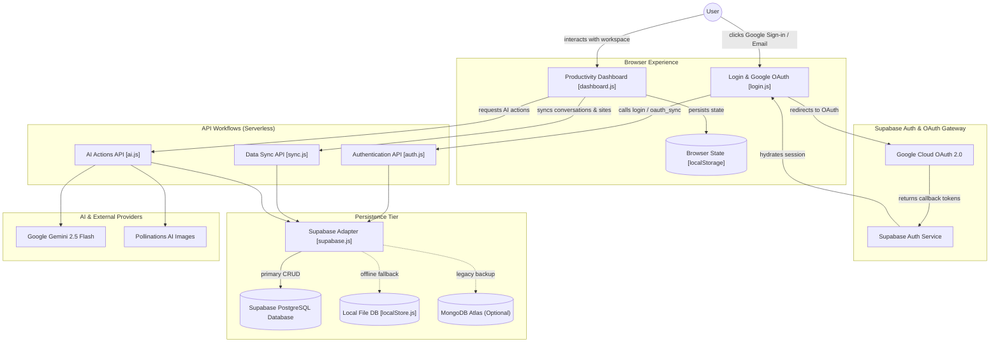

<div align="center">

# 🌌 NOVA AI — Next-Gen AI Productivity Command Center

**An advanced, multi-modal AI productivity platform and developer workspace featuring a Vibrant Neo-Glass aesthetic, real-time intelligence, direct Google OAuth, Supabase Cloud PostgreSQL, and local-first resilience.**

*Created with passion by **[Rohan Mondal](https://github.com/rohanmondal)***

---

[](https://nodejs.org/)
[](https://developer.mozilla.org/en-US/docs/Web/JavaScript)
[](https://ai.google.dev/)
[](https://cloud.google.com/)
[](https://supabase.com/)
[](LICENSE)

[Live Demo](http://localhost:3000/) • [Features](#-core-features) • [Architecture](#-system-architecture) • [Quick Start](#-quick-start) • [Database](#-supabase-database-schema) • [API Reference](#-api-endpoints) • [Deployment](#-deployment)

</div>

---

## 📖 Overview

**NOVA AI** is a full-stack, local-first web application designed to unify everyday engineering, creative ideation, and business productivity into a tactile, distraction-free environment. 

Unlike conventional flat or dark dashboards, NOVA AI introduces a signature **Vibrant Neo-Glass (Neumorphism + Frosted Glassmorphism)** design system:
- **Soft Pearl Ice-Blue Base (`#eef3fb`)** accented by subtle, diffused background **Aurora mesh blobs** (`#00d2ff`, `#4f46e5`, `#9333ea`, `#f43f5e`).
- **Semi-Translucent Frosted Panels (`rgba(255, 255, 255, 0.65)`)** with `backdrop-filter: blur(20px) saturate(180%)`.
- **Tactile Dual Drop Shadows:** Crisp top-left pure white outer glow paired with colorful tinted blue-violet bottom-right depth.
- **Specular Glass Edges:** 1.5px refractive gradient borders transitioning from pure white specular reflections to translucent iridescent rims.
- **Concave Inset Input Sheens:** Carved inward composer pills and search fields providing physical tactile feedback.

---

## ✨ Core Features

### 1. 🔑 Direct Google OAuth & Dual-Mode Authentication
- **"Continue with Google" One-Click Login:** Native Google OAuth powered by Supabase Auth with automatic profile sync (name, email, avatar).
- **Email & Password Authentication:** Standard login and signup with secure `bcryptjs` password hashing and signed JSON Web Tokens (`jsonwebtoken`).
- **Zero-Lockout Guest Mode:** Opens immediately into a functional guest profile (*"Rohan Mondal"*) if offline or unauthenticated, avoiding redirect loops.
- **Session Auto-Hydration:** Seamlessly validates tokens on load and synchronizes user data with the cloud.

### 2. ⚡ Supabase Cloud PostgreSQL Persistence
- **Dedicated PostgreSQL Database:** Robust relational persistence with 5 core tables (`users`, `conversations`, `websites`, `videos`, `memories`).
- **Real-Time Synchronized State:** Instant synchronization of chats, website studio drafts, videos, and personalized AI memory.
- **Local-First Fallback:** Automatic disk fallback (`data/local_db.json`) when offline, ensuring zero data loss even without network connectivity.

### 3. 💬 AI Chat & Long-Term Memory Engine
- **Multi-Turn Context Streaming:** Maintains recent conversational history and streams natural, formatted responses without robotic boilerplate.
- **Automatic Memory Extraction:** Passively extracts and remembers user preferences, active project titles, personal goals, and career roles across sessions.
- **Gemini Quick-Action Cards:** Clickable prompt chips (*Code with NOVA*, *Ideate SaaS Ideas*, *Daily Schedule*, *Multi-Page Website Studio*) that instantly scaffold requests into the chat stream.

### 4. 🗂️ Segmented Dual-Pane Navigation
- **`[ Chat ]` Tab:** Dedicated conversation management featuring real-time client-side thread search, instant `+ New Chat` generation, and recent chat history with timestamps.
- **`[ Mode ]` Tab:** Clean 12-tool workspace launcher routing between AI Chat, AI Studio, Web Studio, Daily Planner, Tasks, Prompt Library, Cloud Sync, and Settings.

### 5. 🌐 AI Multi-File Website Studio
- **Full-Stack Site Generation:** Generates comprehensive multi-file website projects (`index.html`, `about.html`, `styles.css`, `README.md`) based on plain-text descriptions.
- **Interactive Sandboxed Preview:** Renders generated websites directly within an isolated iframe with client-side multi-page routing interception.
- **Deterministic Auto-Repair:** Validates HTML structure and injects fallback styling to ensure every generation renders flawlessly.
- **Direct ZIP Export:** Download generated projects ready for production deployment.

### 6. 📅 AI Daily Productivity Planner
- **Structured Schedule Blocks:** Converts broad goals or daily tasks into timed, prioritized focus blocks (Deep Work, AI Collaboration, Execution Sprint, QA, Wrap-up).
- **Interactive Timeline:** Dynamic status toggling and local state persistence.

### 7. 📄 AI Creative Studio & Document Generator
- Generates polished, publication-ready documents including **Executive Resumes**, **Cover Letters**, **Project Proposals**, and **Business Communications**.

### 8. 🎨 Multi-Modal Media Suite
- **AI Image Generation:** High-resolution visual synthesis powered by Pollinations AI.
- **AI Video Studio:** Text-to-video workflow pre-configured for Hugging Face inference pipelines.

---

## 🏛️ System Architecture



### Component Breakdown
| Layer | Component | File Reference | Primary Responsibility |
| :--- | :--- | :--- | :--- |
| **Browser Experience** | Productivity Dashboard | [`dashboard.js`](dashboard.js) | UI state management, chat streaming, theme rendering, event orchestration |
| | Login Interface | [`login.js`](login.js) | Google OAuth integration via Supabase JS SDK, credential validation, JWT storage |
| | Browser State | `localStorage` | Client-side caching of chats, active projects, tasks, and auth tokens |
| **API Workflows** | Authentication API | [`api/auth.js`](api/auth.js) | Google `oauth_sync`, email signup, login, bcrypt verification, JWT signing |
| | Data Sync API | [`api/sync.js`](api/sync.js) | Real-time synchronization of conversations, multi-file websites, and videos |
| | AI Actions API | [`api/ai.js`](api/ai.js) | Central dispatcher for chat, planner, documents, websites, images, and video |
| **Persistence Tier** | Supabase Adapter | [`api/_utils/supabase.js`](api/_utils/supabase.js) | Serverless Supabase PostgreSQL client handling all 5 application tables |
| | Token Verification | [`api/_utils/auth.js`](api/_utils/auth.js) | Bearer JWT verification and authorization header inspection |
| | Offline Local Store | [`api/_utils/localStore.js`](api/_utils/localStore.js) | Resilient local JSON database fallback when offline |

---

## 🗄️ Supabase Database Schema

NOVA AI utilizes 5 production PostgreSQL tables in Supabase:

```sql
-- 1. Users Table
create table if not exists public.users (
  id text primary key,
  name text not null,
  email text unique not null,
  password text not null,
  created_at timestamp with time zone default now()
);

-- 2. Conversations Table
create table if not exists public.conversations (
  id text primary key,
  user_id text not null,
  title text default 'New Conversation',
  messages jsonb default '[]'::jsonb,
  created_at timestamp with time zone default now(),
  updated_at timestamp with time zone default now()
);

-- 3. Websites Table
create table if not exists public.websites (
  id text primary key,
  user_id text not null,
  name text default 'Untitled Project',
  prompt text default '',
  website_type text default 'Modern Website',
  html text default '',
  files jsonb default '{}'::jsonb,
  created_at timestamp with time zone default now(),
  updated_at timestamp with time zone default now()
);

-- 4. Videos Table
create table if not exists public.videos (
  id text primary key,
  user_id text not null,
  prompt text default '',
  video_url text default '',
  aspect_ratio text default '16:9',
  duration integer default 5,
  model text default 'standard',
  created_at timestamp with time zone default now()
);

-- 5. Memories Table
create table if not exists public.memories (
  id text primary key,
  user_id text not null,
  category text default 'general',
  content text not null,
  created_at timestamp with time zone default now()
);
```

---

## 📂 Project Structure

```text
nova-ai/
├── api/                           # Serverless API endpoints
│   ├── _lib/
│   │   ├── gemini.js              # AI fallback orchestrator & local engine
│   │   └── websiteBuilder.js      # Multi-file web generator & HTML validator
│   ├── _models/                   # Mongoose Schemas (optional secondary DB)
│   ├── _utils/
│   │   ├── auth.js                # JWT token verification
│   │   ├── db.js                  # MongoDB connector
│   │   ├── localStore.js          # File-backed offline database fallback
│   │   └── supabase.js            # Supabase PostgreSQL adapter (Primary DB)
│   ├── ai.js                      # Central AI action dispatcher
│   ├── auth.js                    # Auth gateway (login, signup, oauth_sync, me)
│   └── sync.js                    # State synchronization for chats, sites, videos
├── data/
│   └── local_db.json              # Local persistent offline database
├── config.js                      # Client runtime backend configuration
├── dashboard.html                 # Main Neo-Glass Command Center UI
├── dashboard.js                   # Client state management, chat streaming, UI logic
├── index.html                     # Landing & presentation entry
├── login.html                     # Authentication page with Google OAuth button
├── login.js                       # Auth submission & Supabase OAuth handler
├── package.json                   # Dependencies & npm scripts
├── README.md                      # Complete project documentation
├── server.js                      # Unified local Node.js development server
├── styles.css                     # Neo-Glass & Neumorphism design system
└── vercel.json                    # Vercel production deployment configuration
```

---

## 🚀 Quick Start

### Prerequisites
- **Node.js** (v18.0.0 or higher recommended)
- **npm** (v9.0.0 or higher)

### 1. Clone or Extract
```bash
git clone https://github.com/mondalshefali1982-create/NOVA-AI.git
cd NOVA-AI
```

### 2. Install Dependencies
```bash
npm install
```

### 3. Configure Environment
Create a `.env` file in the root directory (see [`.env.example`](.env.example)):
```env
PORT=3000
GOOGLE_API_KEY=your_gemini_api_key_here
SUPABASE_URL=https://your-project.supabase.co
SUPABASE_ANON_KEY=your_supabase_publishable_anon_key
SUPABASE_SERVICE_ROLE_KEY=your_supabase_secret_key
JWT_SECRET=your_custom_jwt_secret_key
```

### 4. Run the Server
```bash
npm start
```

### 5. Access the Platform
- **Command Center Dashboard:** [http://localhost:3000/](http://localhost:3000/) or [http://localhost:3000/dashboard](http://localhost:3000/dashboard)
- **Authentication Gateway:** [http://localhost:3000/login](http://localhost:3000/login)

---

## 🔌 API Endpoints

### Authentication (`/api/auth`)
| Method | Action | Description | Sample Body |
| :--- | :--- | :--- | :--- |
| `POST` | `oauth_sync` | Synchronizes Google OAuth user & issues JWT | `{ "action": "oauth_sync", "email": "...", "name": "...", "userId": "..." }` |
| `POST` | `signup` | Registers new email user & issues JWT | `{ "action": "signup", "name": "...", "email": "...", "password": "..." }` |
| `POST` | `login` | Validates credentials & issues JWT | `{ "action": "login", "email": "...", "password": "..." }` |
| `POST` | `me` | Validates session Bearer token | `{ "action": "me" }` (with `Authorization: Bearer <token>`) |
| `POST` | `logout` | Clears user session | `{ "action": "logout" }` |

### Core AI Engine (`/api/ai`)
| Action | Description | Key Parameters |
| :--- | :--- | :--- |
| `chat` | Multi-turn conversational intelligence | `message`, `history` (last 8 messages), `systemInstruction` |
| `website` | Multi-page HTML/CSS/JS generation | `prompt`, `existingHtml` (optional), `editPrompt` (optional) |
| `planner` | Structured daily productivity schedule | `input` (day focus / goal) |
| `document` | Professional business writing | `type` (`resume`, `cover letter`, `proposal`), `input` |
| `image` | Visual synthesis via Pollinations AI | `prompt` |
| `video` | Video generation pipeline handoff | `prompt`, `model`, `aspectRatio`, `duration` |

### Cloud & Local Synchronization (`/api/sync`)
| Method | Query / Action | Description |
| :--- | :--- | :--- |
| `GET` | `?action=conversation` | Retrieves active user's conversation threads |
| `GET` | `?action=website` | Retrieves saved website studio projects |
| `GET` | `?action=video` | Retrieves generated video records |
| `POST` | `action: "conversation", subAction: "upsert"` | Persists or updates chat threads in Supabase |
| `POST` | `action: "website", subAction: "upsert"` | Persists multi-file website project structures |
| `POST` | `action: "video", subAction: "upsert"` | Persists video generation records |

---

## 🌐 Deployment

### Deploy to Vercel (Recommended)
1. Push your repository to GitHub.
2. Import the project into your [Vercel Dashboard](https://vercel.com).
3. Set your environment variables in Vercel settings:
   - `GOOGLE_API_KEY`
   - `SUPABASE_URL`
   - `SUPABASE_ANON_KEY`
   - `SUPABASE_SERVICE_ROLE_KEY`
   - `JWT_SECRET`
4. Click **Deploy**. Vercel will automatically build the serverless functions declared in [`vercel.json`](vercel.json).

---

## 🛡️ License & Acknowledgements

- **Author:** Rohan Mondal
- **License:** Released under the [MIT License](LICENSE).
- **Typography:** [Plus Jakarta Sans](https://fonts.google.com/specimen/Plus+Jakarta+Sans), [Inter](https://fonts.google.com/specimen/Inter), and [Space Grotesk](https://fonts.google.com/specimen/Space+Grotesk).
- **Icons:** Feather & Lucide SVG icons.

---

<div align="center">
  <sub>Built with ❤️ and architectural rigor by Rohan Mondal</sub>
</div>
